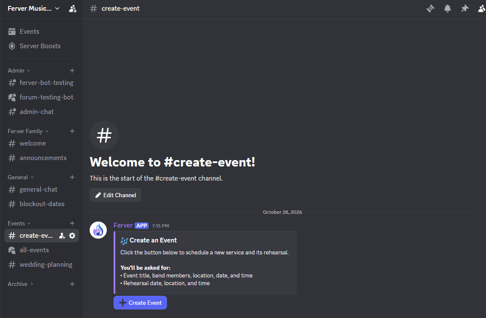
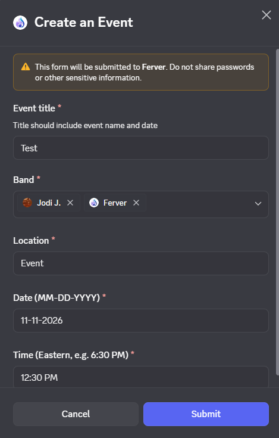
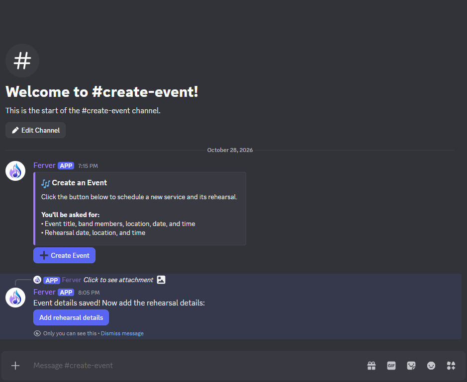
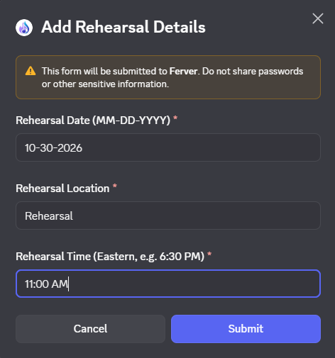
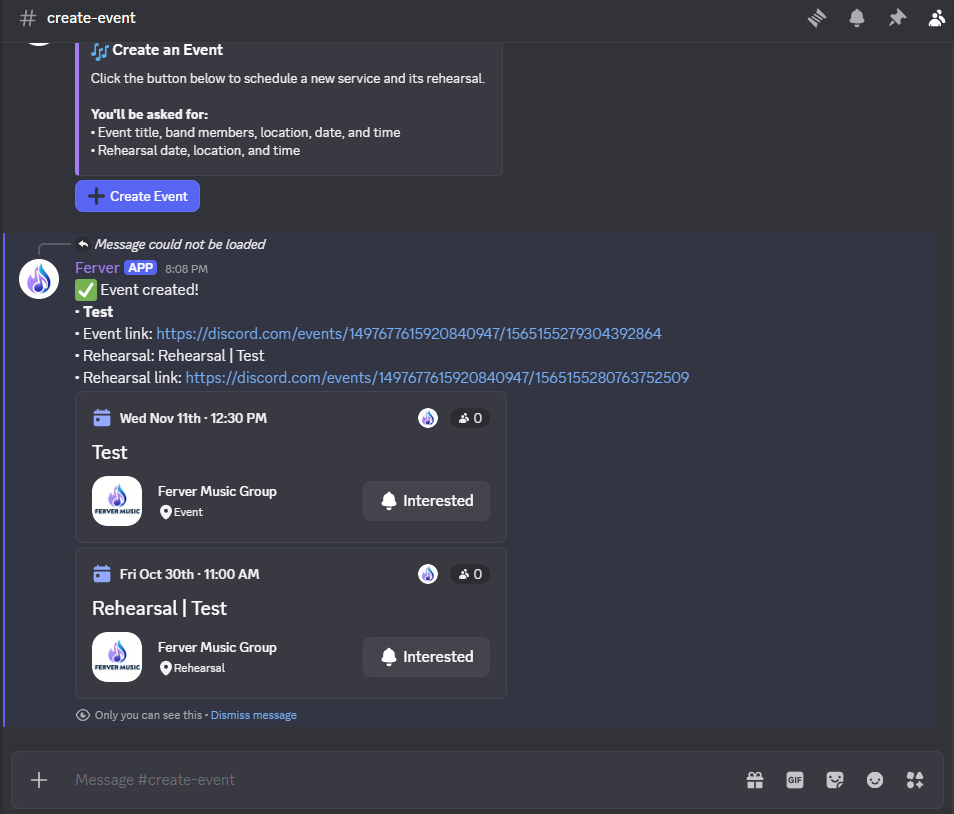
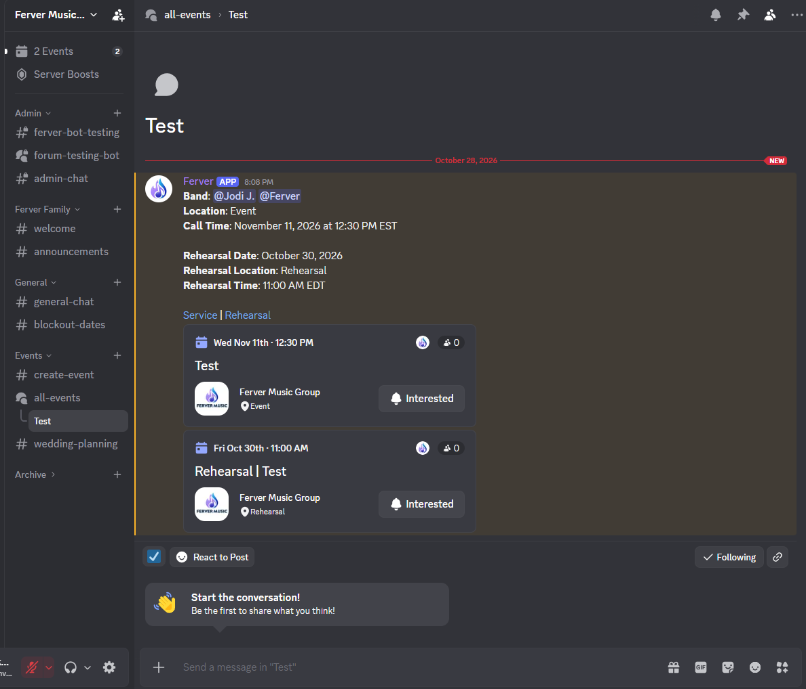
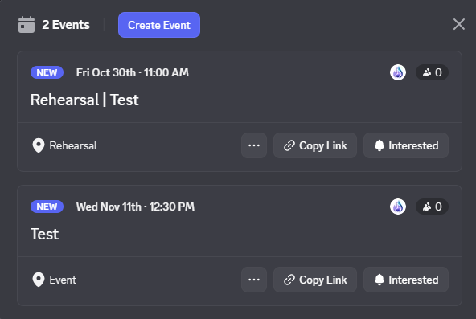

# Ferver Bot

Welcome to the tutorial for the Ferver server bot. This bot is used to create events and rehearsals smoothly.

## How To Use
There are two ways to use the Ferver bot to create an event: the `#create-event` channel, or the `/create-event` slash command.

### The `#create-event` Channel
The simplest way to create an event is by clicking a button in the create event channel. 

Clicking this button will trigger the modal flow. Simply click on the button, and the Ferver bot will start the flow.

### The `/create-event` Slash Command
The `/create-event` slash command can be used in any channel. Simply type `/create-event` in any channel and hit send, and the Ferver bot will start the flow.

## How It Works
Upon invocation, the Ferver bot opens to form to fill out the event details. This includes the event title, location, date, and time. You can also select the band members based on members in the server. 

After you click "Submit", the event details will be saved and the bot will send you a message to add the rehearsal details. 

Click the "Add rehearsal details" button. This button will open another form to fill out the rehearsal details. This includes the rehearsal date, location, and time. 

After you click submit, a message will be sent to confirm that the event has been created properly. This message will delete after 10 seconds to reduce clutter. 

Then, the Ferver bot does the work from there! It creates a post in the `#all-events` channel with the form information. It also creates two Discord events for the event and rehearsal that users can click to indicate their interest. 

Viola!